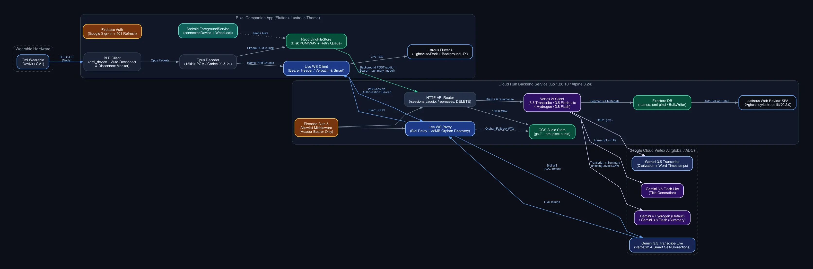
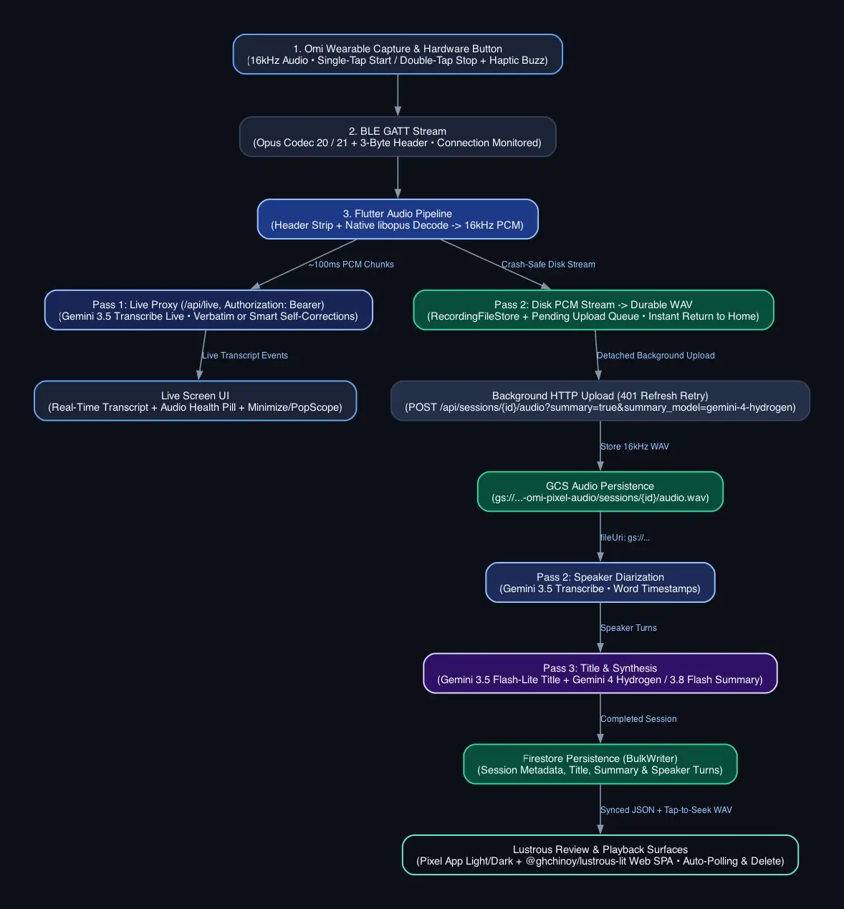

# Developer Guide: Omi-Pixel Architecture and Extension

This document covers the technical architecture, multi-pass speech-to-text pipeline, BLE audio framing contracts, durable local storage, and REST/WebSocket API specifications for the Omi-Pixel companion app and Go Cloud Run backend.

---

## 1. System Architecture

The Omi-Pixel system separates low-latency mobile wearable interaction from structured AI processing and cloud persistence.



The architecture contains three core tiers:

1. **Client Tier (Flutter on Android Pixel + Lustrous Theme)**: Connects to [Omi](https://www.omi.me/) wearable hardware via Bluetooth Low Energy (GATT), monitors connection state drops, strips 3-byte transport headers, decodes Opus audio into 16kHz linear PCM (`libopus`), streams PCM simultaneously to on-device disk storage (`RecordingFileStore`) and the Cloud Run Live WebSocket proxy (`/api/live` via `Authorization: Bearer`), keeps execution alive across app switches/lock screen via an Android `ForegroundService` (`connectedDevice`), and uploads finalized WAVs non-blockingly in the background with a durable retry queue.
2. **AI Provider Tier (Google Cloud Vertex AI — `global` / ADC)**:
   - **Pass 1 (Streaming)**: `gemini-3.5-transcribe-live` via Vertex Live WebSocket proxy (`Verbatim` or `Smart` inline self-correction mode).
   - **Pass 2 (Batch Diarization & Parallel Smart Pass)**: `gemini-3.5-transcribe` via Vertex REST with `audioTranscriptionConfig{diarization: true, wordTimestamp: true}` for speaker-separated turns. When `transcription_mode == "smart"`, a parallel standalone batch call (`diarization: false, wordTimestamp: false, mode: "SMART"`, omitting `languageCodes`) runs concurrently because Vertex AI's `mode: "SMART"` is mutually exclusive with diarization and word timestamps.
   - **Pass 3 (Title & Summary)**: `gemini-3.5-flash-lite` for concise 3–6 word titles and `gemini-4-hydrogen` (default, or `gemini-3.8-flash` via allowlisted `summary_model`; `thinkingLevel: "LOW"`) for plain-text summaries.
3. **Backend Tier (Go `1.26.10` / Alpine `3.24` on Cloud Run)**: Authenticates every protected endpoint via Firebase Admin SDK (`Authorization: Bearer` header strictly) + Firestore `authorized_users` allowlist, relays `/api/live` WebSocket frames with a 32 MB bounded fallback PCM buffer for orphan recovery, orchestrates diarization/Smart/summary passes, persists WAVs in GCS and documents/segments in Firestore (`omi-pixel`, via `BulkWriter`), and serves the Lustrous Web Review SPA (`@ghchinoy/lustrous-lit@0.2.0`).

---

## 2. The Multi-Stage Pipeline



```text
Pass 1 (Live UX):
Omi BLE Audio -> Opus Decode -> 16kHz PCM -> Cloud Run /api/live (Bearer) -> Vertex Live WS -> Verbatim / Smart Live Stream

Pass 2 (Crash-Safe Disk + Non-Blocking Diarization):
16kHz PCM -> RecordingFileStore (.pcm -> .wav + Pending Queue) -> Background POST /audio -> GCS WAV
          -> Vertex 3.5 Transcribe (Diarized Turns [+ Parallel SMART Pass if mode=smart])

Pass 3 (Metadata & Synthesis):
[Smart Transcript +] Diarized Turns -> Gemini 3.5 Flash-Lite (Title) + Gemini 4 Hydrogen (Summary) -> Firestore Session
```

### Pass 1: Real-Time Stream
- The mobile app buffers ~100ms (3,200 bytes) of 16-bit 16kHz mono PCM while also streaming every chunk to `<ApplicationDocumentsDirectory>/omi_recordings/<sessionId>.pcm`.
- `GeminiLiveService` connects to `wss://<host>/api/live?lang=<lang>&mode=<mode>&session=<id>` with `Authorization: Bearer <FIREBASE_ID_TOKEN>` in the HTTP WebSocket upgrade header (never in the query string).
- `LiveProxy` relays audio chunks to Vertex `BidiGenerateContent` (omitting `languageCodes` when `mode=SMART` to avoid Vertex `closeCode=1007`), forwards clean JSON `{type: "transcript", text: "...", isFinal: bool, timestamp: float}` back to Pixel, and buffers up to 32 MB of PCM as a server-side orphan fallback.

### Pass 2 & 3: Non-Blocking Diarization, Smart Transcript, Title & Summary
- On `stopRecording()`, the mobile app closes `.pcm`, streams a 44-byte RIFF header + PCM into `<sessionId>.wav`, enqueues it in `pending_uploads.json`, returns immediately to `HomeScreen` (`status: processing`), and runs the HTTP upload in the background while keeping the Android foreground notification active until complete.
- `ApiClient.uploadAudioDetailed()` retries once with `forceRefresh: true` on HTTP `401`, and local WAVs remain on disk until HTTP `200`/`202` is received.
- On the Go backend, `POST /api/sessions/{id}/audio`:
  1. Persists WAV audio to `gs://<bucket>/sessions/{id}/audio.wav`.
  2. Supports optional `?async=true` returning `202 Accepted` with tracked `WaitGroup` graceful shutdown drain (default synchronous `200 OK` keeps Cloud Run request-based CPU 100% allocated with `--min-instances=0`).
  3. Runs `gemini-3.5-transcribe` diarization (plus parallel standalone `mode=SMART` pass if `transcription_mode == "smart"`).
  4. Synthesizes title (`gemini-3.5-flash-lite`) and plain-text summary (`gemini-4-hydrogen` default or allowlisted `gemini-3.8-flash` with `thinkingLevel: "LOW"`), prioritizing the Smart-corrected wording when available.
  5. Writes session metadata (`title`, `summary`, `smart_transcript`, `transcription_mode`, `status: "completed"`) and segments to Firestore via `BulkWriter`.

---

## 3. BLE Protocol and Audio Codecs

The mobile app uses the `omi_device` Dart SDK (`sdks/device/dart`) and `flutter_blue_plus` (monitoring `BluetoothDevice.connectionState` for mid-recording disconnects).

### GATT Characteristics
- **Service UUID**: `19b10000-e8f2-537e-4f6c-d104768a1214`
- **Audio Stream Characteristic (Notify)**: `19b10001-e8f2-537e-4f6c-d104768a1214`
- **Codec Characteristic (Read)**: `19b10002-e8f2-537e-4f6c-d104768a1214`
- **Battery Level (Read/Notify)**: `00002a19-0000-1000-8000-00805f9b34fb`

### Codec Map

| Codec ID | Name | Hardware | Frame Duration | Sample Rate |
|---|---|---|---|---|
| `0` | PCM 16-bit | Generic | Uncompressed | 16,000 Hz |
| `1` | PCM 8-bit | Generic | Uncompressed | 8,000 Hz |
| `20` (`0x14`) | Opus Standard | [Omi](https://www.omi.me/) DevKit | 10 ms (160 samples) | 16,000 Hz |
| `21` (`0x15`) | Opus FS320 | [Omi](https://www.omi.me/) CV1 | 20 ms (320 samples) | 16,000 Hz |

### Audio Packet Stripping and Decoding
Every BLE notify packet begins with a 3-byte hardware header:
```text
[Byte 0: Seq LSB] [Byte 1: Seq MSB] [Byte 2: Flags] [Bytes 3..N: Compressed Audio]
```
`stripPacketHeader(packet)` removes the first 3 bytes; `AudioDecoder.instance.decodePayload()` decodes Opus via native `libopus` (`opus_dart` + `opus_flutter`) into 16-bit little-endian mono PCM at 16,000 Hz.

---

## 4. Module and File Map

### Mobile Companion (`app/`)
```text
app/lib/
├── firebase_options.dart          # FlutterFire generated platform configurations
├── main.dart                      # Bootstrap, LustrousTheme Light/Dark/System, /live route & notification tap handler
├── models/
│   ├── device.dart                # OmiDeviceInfo and DeviceCodec definitions
│   ├── segment.dart               # Speaker turn segment model
│   └── session.dart               # Session model (status, transcriptionMode, smartTranscript, segments)
├── services/
│   ├── api_client.dart            # Authenticated HTTP client (401 token refresh, upload, reprocess, delete)
│   ├── audio_decoder.dart         # Native libopus wrapper & 44-byte RIFF WAV header/encoder
│   ├── auth_service.dart          # Firebase Auth & Google Sign-In with forceRefresh token support
│   ├── ble_service.dart           # BLE scan, auto-reconnect, battery & connectionState disconnect monitor
│   ├── gemini_live_service.dart   # Authenticated WebSocket client (/api/live via Authorization header)
│   ├── recording_file_store.dart  # Disk PCM streaming, WAV finalization, crash recovery & pending upload queue
│   ├── session_manager.dart       # Recording coordinator, ForegroundService, audio health & background upload
│   └── settings_service.dart      # SharedPreferences (URL, theme, live mode, summary model, language)
├── theme/
│   └── lustrous_theme.dart        # Lustrous Light/Dark ThemeData & LustrousColors ThemeExtension (WCAG-AA)
└── ui/
    ├── home_screen.dart           # BLE status, active-recording banner, long-press mode picker, pending uploads, sessions
    ├── live_screen.dart           # PopScope guard, minimize flow, audio health pill, live transcript
    ├── login_screen.dart          # Google Sign-In screen
    ├── session_detail_screen.dart # Smart/Diarized switcher, WAV seek player, AI Summary, retry & delete
    └── settings_screen.dart       # Account, Cloud Run URL, summary model, Light/Auto/Dark, battery exemption
```

### Go Backend (`service/`)
```text
service/
├── .dockerignore / .gcloudignore  # Build & Cloud Build upload exclusions
├── Dockerfile                     # Multi-stage Alpine 3.24 container build (Go 1.26, apk upgrade in both stages)
├── auth.go                        # Firebase Admin SDK Bearer-header verification & allowlist cache
├── gemini.go                      # Vertex AI 3.5 Transcribe (diarized + parallel SMART), Flash-Lite, 4 Hydrogen / 3.8 Flash
├── go.mod / go.sum                # Go 1.26.10 module floor (firestore, storage, firebase, coder/websocket, oauth2)
├── handlers.go                    # REST routes (/sessions, /audio, /reprocess, DELETE, /segments, /health)
├── handlers_test.go               # Go unit tests (routing, auth header, async 202, summary allowlist, delete/orphan)
├── live.go                        # Bidirectional /api/live proxy + 32 MB orphan PCM recovery
├── main.go                        # HTTP server config & graceful SIGTERM drain (HTTP + background jobs)
├── storage.go                     # GCS AudioStore & bounded NoopAudioStore (UploadWAV, DownloadWAV, DeleteWAV)
├── store.go                       # Store interface, FirestoreStore (BulkWriter) & MemoryStore
├── version.go                     # Build-time semantic Version string
└── web/
    └── templates.go               # @ghchinoy/lustrous-lit@0.2.0 Web Review SPA (Light/Auto/Dark, search, Smart toggle)
```

### Infrastructure Automation (`infra/`)
```text
infra/
├── .env.template                  # Environment configuration template
├── authorize-user.sh              # Adds/removes emails in Firestore authorized_users allowlist
├── deploy.sh                      # Cloud Run deployment script (dedicated SA, min-instances=0, 3600s timeout)
├── postflight.sh                  # Post-deployment health, auth, Firestore, and GCS verification
├── preflight.sh                   # Pre-deployment validation checks
└── setup.sh                       # GCP API enablement, SA/IAM binding, Firestore DB, and GCS bucket creation
```

---

## 5. Backend REST & WebSocket API Specification

### Health Check
- **Endpoint**: `GET /api/health`
- **Auth**: Public
- **Response**: `200 OK`
  ```json
  { "service": "omi-pixel", "status": "ok", "version": "0.4.1" }
  ```

### Live Transcription WebSocket
- **Endpoint**: `GET /api/live?lang=en&mode=verbatim|smart&session=sess_12345678`
- **Auth**: Required via HTTP upgrade header **`Authorization: Bearer <FIREBASE_ID_TOKEN>`** (query-string `access_token` is rejected so JWTs never appear in request logs).
- **Protocol**: Client sends `{"audio":"<b64>","mimeType":"audio/pcm;rate=16000"}`; server streams `{"type":"ready"|"transcript"|"activity"|"error",...}`. If the client disconnects without uploading audio, `LiveProxy` waits 15s and recovers up to 32 MB of buffered PCM to GCS WAV while transitioning the session out of `recording`.

### Create Session Metadata
- **Endpoint**: `POST /api/sessions`
- **Auth**: Required (`Authorization: Bearer <ID_TOKEN>`)
- **Request Body**:
  ```json
  {
    "id": "sess_12345678",
    "device_id": "omi_cv1",
    "title": "Team Sync",
    "language": "en",
    "transcription_mode": "smart",
    "started_at": "2026-11-23T10:00:00Z"
  }
  ```
- **Response**: `201 Created` with the initialized `Session` object.

### Upload Session Audio and Run Diarization
- **Endpoint**: `POST /api/sessions/{id}/audio?summary=true|false&summary_model=gemini-4-hydrogen|gemini-3.8-flash&mode=verbatim|smart[&async=true]`
- **Auth**: Required (`Authorization: Bearer <ID_TOKEN>`)
- **Headers**: `Content-Type: multipart/form-data` (field `audio`) or `Content-Type: audio/wav` (50 MB max body).
- **Response**:
  - Default: `200 OK` with completed `SessionDetail` (`Session` metadata including optional `smart_transcript` + `segments` array).
  - With `async=true`: `202 Accepted` with `status: "processing"` immediately after GCS persistence while diarization completes in a tracked background goroutine.

### Reprocess Stored Audio
- **Endpoint**: `POST /api/sessions/{id}/reprocess?summary=true|false&summary_model=...&mode=...[&async=true]`
- **Auth**: Required (`Authorization: Bearer <ID_TOKEN>`)
- **Behavior**: Downloads existing `sessions/{id}/audio.wav` from `AudioStore` and re-runs diarization/Smart/summary without re-uploading from the phone.

### Download Session Audio
- **Endpoint**: `GET /api/sessions/{id}/audio`
- **Auth**: Required (`Authorization: Bearer <ID_TOKEN>`)
- **Response**: `200 OK` streaming `audio/wav` with `Accept-Ranges: bytes` and `Content-Length`.

### List / Get / Delete Sessions
- **`GET /api/sessions`**: `200 OK` — JSON array of the 50 most recent sessions.
- **`GET /api/sessions/{id}`**: `200 OK` — full `SessionDetail` JSON (`Session` + `segments`).
- **`DELETE /api/sessions/{id}`**: `200 OK` — deletes GCS WAV, Firestore `segments` subcollection (`BulkWriter`), and the session document.

### Direct Segments / Status Update (Fallback & 0-Audio Finalization)
- **Endpoint**: `POST /api/sessions/{id}/segments`
- **Auth**: Required (`Authorization: Bearer <ID_TOKEN>`)
- **Request Body**:
  ```json
  {
    "title": "Offline Conversation",
    "summary": "Imported transcript",
    "status": "completed",
    "segments": [
      { "speaker": "Speaker 1", "speaker_id": 0, "text": "Hello world", "start": 0.0, "end": 2.5 }
    ]
  }
  ```
  *(Pass `"status": "failed"` with empty `segments` to transition 0-audio captures cleanly out of `recording`.)*

---

## 6. Build and Verification Suite

```bash
# Run full Go + Flutter unit/widget tests
make test

# Run Go vet + Flutter analyze
make analyze

# Race detector & Go linter
cd service && go test -race ./... && golangci-lint run ./...

# Security vulnerability check (Go)
cd service && go run golang.org/x/vuln/cmd/govulncheck@latest ./...
```

---

## 7. Extension Points

1. **Custom Speaker Naming**: Extend `SessionDetailScreen` and the Web Review SPA to let users rename `Speaker 1`/`Speaker 2` labels and persist speaker aliases back to Firestore.
2. **Cloud Tasks Worker Queue**: If deploying with strict request-based CPU throttling and wanting server-side `202 Accepted` diarization detached from mobile HTTP timeouts, wire `handleUploadAudio?async=true` to enqueue an OIDC-authenticated Cloud Tasks HTTP job targeting `POST /api/sessions/{id}/reprocess`.
3. **Full-Text Search & Export**: Extend `Store` with Firestore vector/keyword indexing or Markdown/Obsidian export from the Web Review SPA.
